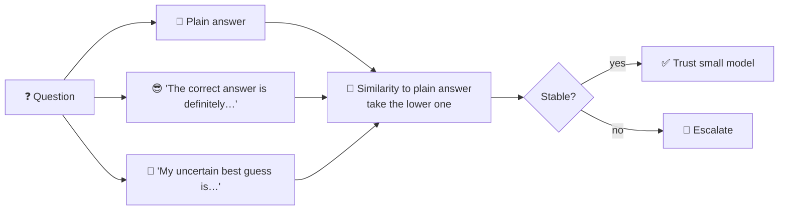

# 🎭 SLM Uncertain-Expression Probe


-2EA44F)


> Nudge the model to sound sure, then unsure. If its answer changes, it was probably guessing.

## ⚙️ How it works



- **Three answers** per question, all greedy (T = 0): plain, confident-framed and uncertain-framed. The framing is injected straight into the assistant's turn using Qwen's own chat template (`raw=True`).
- **Consistency score:** `all-MiniLM-L6-v2` similarity between the plain answer and each framed one; the **minimum** of the two is used (the paper's best "ensemble" variant).
- **Label:** plain answer vs. ground truth, similarity ≥ 0.55 = correct.
- **Black-box:** only text in, text out. No hidden states, no logprobs, works with any model behind an API.

Based on Joo et al., *Black-Box Hallucination Detection via Consistency Under the Uncertain Expression*, 2025 · [arXiv:2509.21999](https://arxiv.org/abs/2509.21999)

## 📊 Results (350 medical questions)

| | |
|---|---|
| 🎯 Small model accuracy | **76.9%** (269 / 350) |
| 📈 Avg consistency: correct vs. wrong answers | **0.587 vs. 0.567** |
| 🪤 Wrong answers caught, escalating lowest 10% | **13 / 81** (random would catch ~8) |
| 🪤 Wrong answers caught, escalating lowest 20% | **19 / 81** (random would catch ~16) |
| 📈 Accuracy on the most stable 40% | **80.7%** (vs. 76.9% overall) |

💡 **Takeaway:** a weak signal. It beats random at small escalation budgets, but the gap shrinks fast. As the paper itself notes, some answers stay wrong *and* stable under any framing, and no black-box signal can catch those.

## 🚀 Run it

```bash
pip install -r requirements.txt
ollama pull qwen2.5:1.5b
python uncertain_expression_probe.py              # full run, 350 questions (~3 calls each)
python uncertain_expression_probe.py --mock --n-rows 60   # quick check with synthetic data, no Ollama
```

## 📁 Files

| | |
|---|---|
| `uncertain_expression_probe.py` | Generate the three answers → score consistency → evaluate |
| `data/` | 120- and 350-question stratified MedHallu subsets |
| `results/` | Summary (`.json`) and every question's three answers, label and scores |

## 📚 Dataset & licence

`data/` contains subsets of **MedHallu** (MIT licence), whose questions come from **PubMedQA** (MIT). Please cite the originals:

- Pandit et al., *MedHallu: A Comprehensive Benchmark for Detecting Medical Hallucinations in Large Language Models*, 2025 · [arXiv](https://arxiv.org/abs/2502.14302) · [GitHub](https://github.com/MedHallu/MedHallu) · [Hugging Face](https://huggingface.co/datasets/UTAustin-AIHealth/MedHallu)
- Jin et al., *PubMedQA: A Dataset for Biomedical Research Question Answering*, EMNLP 2019 · [GitHub](https://github.com/pubmedqa/pubmedqa)
